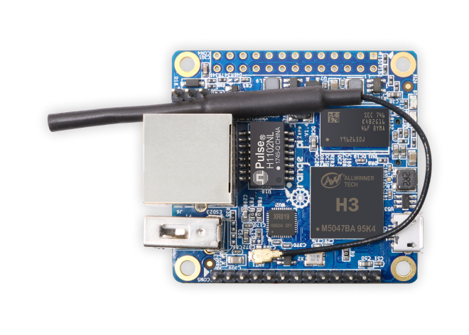

# opz-dev Software Repository

Development repository for the Orange Pi Zero (Allwinner H2+, quad
Cortex-A7 @ 1.296 GHz, 512 MiB DDR3) running
**Armbian community 26.11.0-trunk.108** (Ubuntu "resolute" base, kernel
`6.18.57-current-sunxi`, armv7l hard-float). Rootfs on a 7.5 GB TF card,
zram swap. No on-board display output - everything happens over the
network / serial.



Connector close-ups live in [board_images/](board_images/).

## Board connection (verified working)

- Windows: `ssh opz` - alias in `C:\Users\user1\.ssh\config`
  (`orangepizero.local`, user `dev`, key `id_rsa_pocket`). mDNS
  resolution works on Windows, passwordless login is set up.
- WSL: same alias `opz` in `~/.ssh/config`, but with the **numeric IP**
  (`192.168.5.223`, the `end0` Ethernet address) - WSL2 does not resolve
  mDNS `.local` names. The private key is copied to `~/.ssh/id_rsa_pocket`
  (0600); `/mnt/c/...` copies are rejected by Linux ssh (permissions).
  The board also holds a WiFi address (`wld1`, seen `192.168.5.218`) -
  if the DHCP lease moves, run `tools/find_board.sh`.
- Login: `dev` / `pocket` (the key is installed, so passwords are only
  needed for `sudo` on the board).
- Serial console: debug header, 115200 8N1 (COM6 or COM7 on this PC,
  check with `[System.IO.Ports.SerialPort]::GetPortNames()`) - rescue
  access when the network is gone.

Vendor docs (H2+ datasheet, schematic, user manual) live in
`D:\board_database\orangepi-zero` and are **not** part of this repo
(see `docs/README.md`).

## Toolchain (verified end-to-end)

Distro cross compiler from the WSL Ubuntu archive - no vendor SDK needed
because the board runs a normal Ubuntu userland (glibc):

```
sudo apt install gcc-arm-linux-gnueabihf    # GCC 15.2.0, armv7-a hard-float
```

Installed in WSL as `arm-linux-gnueabihf-gcc`; `env.sh` only exports the
prefix and the ssh alias. The board also has native `gcc`/`make`/`python3`
(`build-remote` target in each app's Makefile uses it).

Cross build + fast deploy loop (from `app/<project>/`):

```
make push    # cross-compile and scp the binary
make run     # execute it on the board
make deploy  # push sources too (for remote builds)
```

Debugging: printf so far; `gdbserver` can be installed on the board via
apt (`sudo apt install gdb-multiarch` on WSL + `gdbserver` on board) if
needed.

## Board facts (verified)

| Item | Value |
|---|---|
| SoC | Allwinner H2+ (sun8i), 4x Cortex-A7, max freq 1296 MHz |
| RAM | 484 MiB visible (512 MiB part), zram swap |
| Storage | TF card rootfs (`mmcblk0`), no eMMC |
| Ethernet | 100M, interface `end0` (DHCP, currently 192.168.5.223) |
| WiFi | interface `wld1` (currently 192.168.5.218) |
| LEDs | `orangepi:green:pwr` (power), `orangepi:red:status` - both start with trigger `none`, free for apps |
| Temperature | `/sys/class/thermal/thermal_zone0` (`cpu_thermal`, hwmon driver name `cpu_thermal` = Allwinner THS **die sensor**, millidegrees C) |
| GPIO/I2C/SPI | via CON4 26-pin header - see `docs/con4-header.md` (verified pinout, I2C0 via overlay) |

LED control: `echo heartbeat > /sys/class/leds/orangepi:red:status/trigger`
or `echo 1 > .../brightness` - works as the `dev` user without root: a
udev rule (`tools/leds.rules`, installed once by
`tools/setup_led_group.sh`) delegates `brightness`/`trigger` writes to
group `leds` (`dev` is a member; `max_brightness` is 1). Without the rule
the nodes are root-owned 0644 - use `sudo` as fallback.

## ADC (verified: none)

The H2+ SoC has **no general-purpose ADC** and the Armbian kernel has no
IIO subsystem at all (`/sys/bus/iio/devices/` does not exist; nothing
under hwmon except the THS die sensor). The only analog-ish input is the
internal die temperature above - not usable for external signals. For
real analog inputs, add an external I2C/SPI ADC (26-pin header has I2C/SPI,
after enabling the overlays).

## Applications

| App | What it drives | Notes |
|---|---|---|
| `app/hello` | - | toolchain smoke test |
| `app/blink_hello` | both LEDs (green pwr / red status) + die temp | alternate blink, restores triggers on exit; runs without root (LED group delegation) |
| `app/coremark` | - | EEMBC CoreMark 1.0, ARM + Thumb-2, results in its README |
| `app/ssd1317_md066_64x48_iic` | SSD1317 64x48 I2C OLED on CON4.3/5 + RES PA6 | ported from rk3506-dev; runs without root |
| `app/ili9163c_md144_128x128_spi` | ILI9163C 1.44" 128x128 SPI LCD on CON4 | hw SPI1 (`/dev/spidev1.0`), RES PA6 (CON4.7, shared - one module at a time); runs without root |
| `app/st7789_md130_240x240` | ST7789V 1.3" 240x240 SPI TFT on CON4 | hw SPI1 mode 3, DC PA1, RES PA6, BLK 3.3V full-on; **stuck after first frame - mode 3 on sunxi SPI1 implicated, `docs/st7789_md130_issue.md`** |
| `app/st7789_md169_240x280_spi` | ST7789V 1.69" 240x280 SPI TFT on CON4 | hw SPI1 mode 0, DC PA1, RES PA6, V50/BLK 3.3V; **verified working** - proved the MD130 issue is mode-3-specific |
| `app/rec_wav` | audio recorder | up to 30 s WAV, `q` early-stop, MP3/OGG/FLAC via on-board encoders; H3 codec (mic on CON5), PulseAudio disabled |
| `app/netbench` | TCP throughput benchmark for end0 + wld1 | `make bench` runs both interfaces, both directions; results in its README |
| `app/uvc_to_st7789_md169_240x280_spi` | UVC camera -> MD169 panel streamer | auto-detect, `uh-N` + fps band, `UVC NA` fallback; MJPEG via board libjpeg |
| `app/e_server` | embedded web server (port 8080) | LED control, CPU temp plot, MJPEG camera `/stream`, board info; ported from mp157-dk1-prj |

## References

- H2+ datasheet: `D:\board_database\orangepi-zero\Allwinner_H2+_Datasheet_V1.2.pdf`
- Schematic: `D:\board_database\orangepi-zero\OrangePi_zero_schematic_v1.5.pdf`
  - **Erratum (verified)**: sheet 4 "GPIO ASSIGNMENT" marks
    `PA15 = STATUS-LED`, `PA16 = MUTE`, `PA17 = SPDIF-OUT`. The running
    system disagrees: the red status LED is on **PA17** (gpio-17,
    `/sys/kernel/debug/gpio`, matches the vendor manual LED table and the
    mainline sun8i-h3-orangepi-zero DT), and PA15 is a free SPI1_MOSI.
    Do not trust sheet 4's PA15/PA16/PA17 rows.
- User manual (CN): `D:\board_database\orangepi-zero\OrangePi_Zero_H2+_用户手册_v3.2.pdf`
- Armbian docs: https://docs.armbian.com - `orangepi-build` is only needed
  for rebuilding OS images/kernels, not for applications
